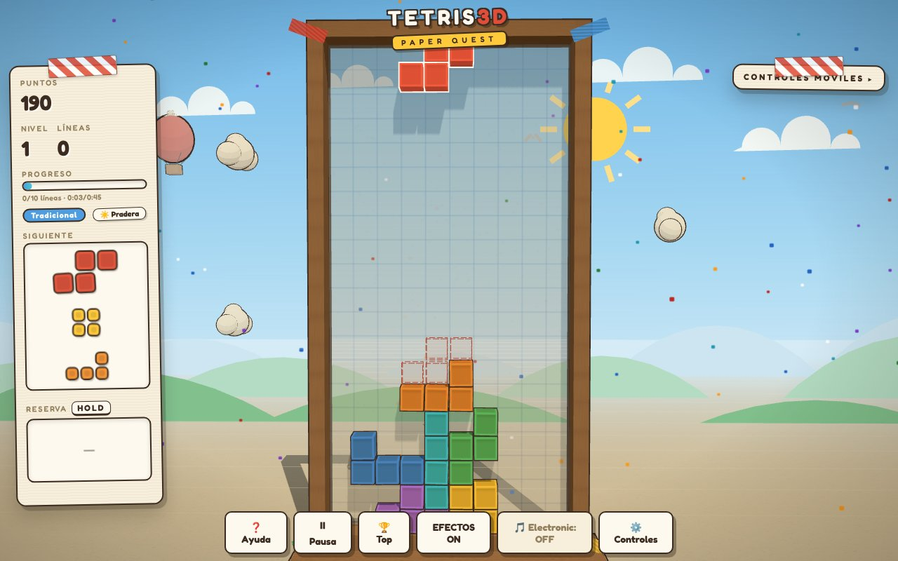
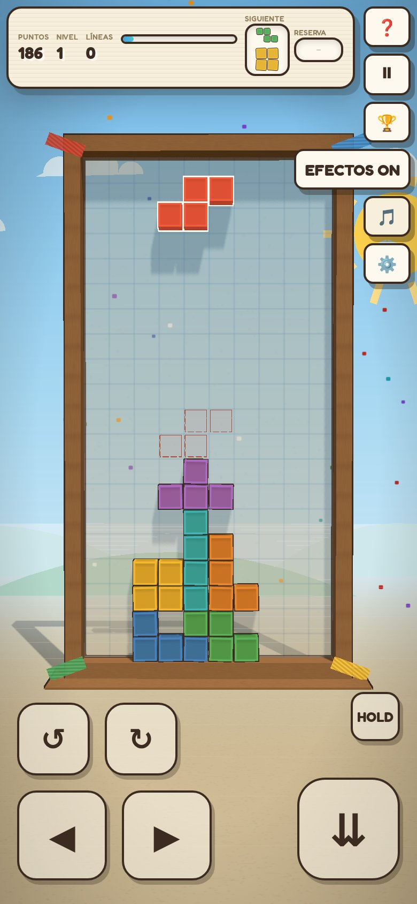
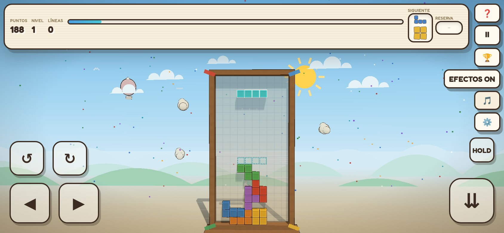

# TETRIS 3D · Paper Quest

Tetris 3D jugable en el navegador con **TypeScript + three.js**: bloques voxel con aspecto de
papel recortado, diorama de cartón y papel, partículas de confeti, cámara con deriva sutil, HUD
como fichas de papel y efectos de sonido sintetizados con WebAudio.



| Móvil vertical | Móvil horizontal |
|---|---|
|  |  |

> Con los **efectos activados** el panel del tablero es translúcido y el escenario se ve a
> través de él (las sombras de los bloques se recortan contra el fondo); al apagarlos el
> panel vuelve a ser sólido, más barato de renderizar. Capturas generadas con
> `npm run shots` (`tools/screenshots.mjs`).

## Requisitos

- Node.js 22.12+ y npm (Vite 8 y Vitest 5 exigen Node moderno).

## Instalación y ejecución

```bash
npm install
npm run dev      # local: http://localhost:5173 · LAN: http://<tu-IP>:5173
```

La clasificación necesita el API (Vercel Function) y una base Upstash: en local se
levantan en dos terminales y Vite hace proxy de `/api` al puerto 3000.

```bash
npx vercel link          # una sola vez, para leer el proyecto y las env vars
cp .env.example .env.local   # o `npx vercel env pull .env.local`
npm run dev:api          # API en http://localhost:3000
npm run dev              # juego en http://localhost:5173 (proxy /api)
```

Sin el API levantado el juego funciona igual: el ranking muestra un aviso de
conexión y el envío de puntaje se puede reintentar.

```bash
npm test         # tests de lógica (vitest 5, 195 tests)
npm run build    # type-check (tsc 7 nativo) + type-check del API + bundle Rolldown/Oxc
npm run preview  # sirve dist/ (también en LAN: http://<tu-IP>:4173)
npm run curate   # (opcional) regenera las semillas curadas de la música
npm run shots    # (opcional) regenera las capturas del README (ver tools/screenshots.mjs)
```

## Controles

| Tecla | Acción |
|---|---|
| ← / → | Mover pieza (con auto-repetición DAS/ARR) |
| ↓ | Caída suave (+1 pto/fila) |
| ↑ / X | Rotar horario (SRS con wall-kicks) |
| Z | Rotar antihorario |
| Espacio | Caída instantánea (+2 ptos/fila, con fantasma) |
| C | Reserva (hold, un uso por pieza) |
| E | Efectos del fondo on/off (clima, personajes, escenarios) |
| M | Música procedural on/off |
| H | Ayuda (bloques y ayudas del juego) |
| P / Esc | Pausa |
| R | Reinicio |
| Enter | Confirmar (jugar / continuar / reintentar) |

### Controles táctiles (móvil / tableta)

En modo táctil los botones se agrupan en dos clusters a los lados del tablero
(con multitáctil real: varios botones a la vez), más una **columna vertical de
utilidades** (❓ ⏸ ✨ 🎵 ⚙️) pegada al borde derecho:

| Control táctil | Acción |
|---|---|
| ↺ / ↻ (grandes, sobre ◀/▶) | Rotar antihorario / horario |
| ◀ / ▶ | Mover pieza (con auto-repetición DAS/ARR) |
| ⇊ (grande, abajo-derecha) | Caída instantánea |
| HOLD (aislada, arriba) | Reserva |
| ❓ · ⏸ · ✨ · 🎵 · ⚙️ (columna derecha) | Ayuda · Pausa · Efectos · Música · Controles |

La rotación vive encima de ◀/▶ y lejos de ⇊ para no tirar la pieza al rotar;
la HOLD va aislada arriba (lejos del ⇊) para no soltarla por accidente.

**Arrastrar y tocar la pieza** (siempre disponible junto a los botones):

| Gesto | Acción |
|---|---|
| Arrastrar en horizontal | Mover la pieza celda a celda (sigue al dedo) |
| Arrastrar hacia abajo | Caída suave celda a celda (subir no la retrocede) |
| Tocar el tablero | Rotar en sentido horario |

El gesto nunca dispara caída instantánea: eso solo vive en ⇊.

El modo se elige automáticamente por detección de dispositivo; si la detección
es ambigua aparece una pantalla de selección al arrancar y la elección persiste
en `localStorage` (se puede cambiar con **⚙️ Controles**).

## Reglas

- Tablero 10×20, 7 piezas clásicas con aleatorio 7-bag.
- Gravedad progresiva por nivel: 100/300/500/800 × nivel, bonus de combo
  +50×combo×nivel, Tetris destacado.
- **Subida de nivel híbrida**: 10 líneas **o 45 s** de juego (lo que llegue
  antes), con tope en el nivel 20. Al subir por líneas el reloj del nivel se
  reinicia y viceversa.
- **Gauge de dificultad** en el HUD: se llena hacia el siguiente nivel y su
  color/leyenda indican la regla que va ganando (líneas en verde, reloj en azul).
- **Selector de nivel inicial (1–20)** en la pantalla de inicio; el nivel
  elegido también fija el escenario de arranque.
- **Modo Caos** (se elige en la pantalla de inicio, junto al nivel): el juego
  clásico con **powerups literales**. Cada cierto tiempo cae un objeto 💣 ⚡ 🔩
  en vez de una pieza (se anuncia con badge en el preview y con un chip
  coloreado por tipo en el HUD) y, al bloquearse, aplica su efecto y desaparece
  sin dejar bloques:
  - 💣 **Bomba**: revienta 2 filas (la de aterrizaje y la contigua).
  - ⚡ **Rayo**: rompe los 4 bloques más altos bajo su base.
  - 🔩 **Taladro**: se hunde 2 filas destruyendo lo que tiene debajo (una sola
    vez por pieza; viaja con la reserva).
  La secuencia es **determinista por semilla** (misma semilla ⇒ mismos
  powerups). Al sostener un powerup el tablero muestra su **zona de impacto**
  (las 2 filas de la bomba, los bloques del rayo, las celdas del taladro) con
  una guía pulsante, y el objeto flota y gira sobre la pieza fantasma.
  **Tradicional es siempre el modo por defecto al arrancar**: elegir Caos vale
  solo para la partida que se empieza y no se recuerda entre sesiones.
- **Tormentas del Caos** (solo en Caos): a los 18 s llega la primera, avisada
  1,6 s antes; luego hay 12 s de calma. Solo hay una a la vez y no se repite la
  misma dos veces seguidas. El chip del HUD se colorea según la tormenta.
  - 🌬️ **Viento**: sopla cada 6 s durante 18 s. Una flecha marca la dirección
    **1,2 s antes** de cada empuje; la pieza activa se mueve 1 celda si cabe
    (contra la pared el golpe se pierde). Los personajes se inclinan y vuelan
    papeles de fondo.
  - 🌧️ **Lluvia**: durante 18 s el suelo resbala. Cada movimiento lateral del
    jugador (pulsación, repetición DAS o arrastre táctil) desplaza 1 celda y,
    si la siguiente está libre, **desliza 1 más** en la misma dirección. Cuenta
    como una sola acción (un reset de lock delay y un sonido); el viento no
    provoca deslizamiento. El ambiente se oscurece y los personajes se cubren
    con paraguas.
  - ⚡ **Relámpago**: cada 5 s un rayo rompe el bloque más alto de 3 columnas
    ocupadas. El tablero dibuja el rayo dentado y el cielo destella aunque el
    escenario no sea tormentoso.
  - 🌨️ **Granizo**: cada 2,2 s deja hielo en 2 columnas al azar (se ve caer y
    brilla); a los 7 s se derrite con chispas. El chip indica las columnas
    golpeadas.
  - 🔩 **Taladro**: 1,2 s antes de perforar, un haz pulsante con flecha marca
    la columna objetivo; la perforación baja hasta el fondo y convierte la
    columna en roca roja (`R`), que se limpia con las líneas como el resto.
  Qué tormenta toca y hacia dónde sopla sale del **RNG con semilla del motor**
  (reproducible); las guías, partículas y el resto de la puesta en escena usan
  el RNG cosmético.
- **Escenarios y clima**: los niveles 1–2 usan el tema clásico en papel (☀️
  Pradera) con su clima y personajes de fondo (globo, pájaros, conejo, pingüino
  y OVNI); al apagar los efectos, ese mismo diorama queda congelado como fondo
  clásico. Desde el nivel 3 el fondo lo toman **escenarios 3D modulares** que
  rotan cada 5 niveles con un fundido de ~2 s: 🌲 **Bosque** (3–5), 🌃 **Ciudad
  nocturna** (6–10), 🚀 **Espacio** (11–15) y 🌊 **Fondo del mar** (16–20). Cada
  uno aporta su escenografía, paleta, luces y suelo propios, los personajes se
  tiñen a juego, el chip del HUD muestra el escenario actual y al cambiar se
  libera su memoria de GPU. El clima procedural (hojas, lluvia, nieve,
  estrellas, luciérnagas, fugaces) y las tormentas del Caos se dibujan por
  encima.
- **Toggle de efectos** (botón o tecla E): apaga clima, personajes, confeti y
  cambios de tema, dejando el fondo clásico congelado. Con efectos el panel del
  tablero es **translúcido** (el escenario se ve detrás de las piezas y las
  sombras se recortan contra él); sin ellos vuelve a ser sólido para ahorrar
  render. La preferencia se guarda en `localStorage` y arranca apagada si el
  sistema pide movimiento reducido.
- **Escombros cosméticos** (exclusivos del modo Caos): cada celda eliminada se
  convierte en un cubito con gravedad, rebote y giro propios que se desvanece en 1–2 s. El
  sistema tiene pool fijo, recicla los cuerpos más antiguos al superar el
  límite, usa un RNG de efectos independiente del motor y respeta la calidad
  baja/media/alta y `prefers-reduced-motion`. No altera el tablero ni las reglas.
- **Música procedural adaptativa** (botón o tecla M): generada en vivo con la
  Web Audio API, sin ficheros. Escala dórica de La; cada semilla fija una
  canción con variación (3 progresiones × 6 grooves × 4 rotaciones = 72
  combinaciones, con swing opcional) y el arpegio se mueve en pentatónica. Un
  único parámetro `intensity` (0–1) controla capas (pad siempre, bajo ≥ 0.2,
  arpegio ≥ 0.4, percusión ≥ 0.6), tempo (70→100 BPM) y brillo. Las partidas
  usan semillas de una **lista curada** (`npm run curate`, 50 semillas con
  cobertura de los 18 estilos); la semilla de cada partida se loguea en
  consola para reproducirla. Scheduler lookahead determinista (misma semilla ⇒
  misma canción). Pausa con el juego y con la pestaña oculta; preferencia
  guardada en `localStorage`.
- Lock delay de 0.5 s con hasta 15 reseteos al mover/rotar.
- Pieza fantasma, vista previa de las 3 piezas siguientes y reserva.
- **Pantalla de ayuda** (tecla `H`, visible al inicio): explica los 7 bloques y
  todas las ayudas del juego. Abrirla durante la partida pausa el juego.
- Pausa, reinicio y pantalla de fin de juego con puntuación.

## Arquitectura

```
src/
  game/       Lógica pura sin DOM (testeable con vitest)
    types.ts      Tipos, constantes (líneas/segundos/nivel, tope, powerups caos), colores, puntos
    pieces.ts     Formas, rotación, kicks SRS, 7-bag
    board.ts      Grid, colisiones, fusión, limpieza
    rng.ts        mulberry32 + semilla (determinismo del modo caos)
    engine.ts     Estado, gravedad, lock delay, niveles híbridos, gauge, hold, powerups y tormentas caos
    mutators/     Tormentas del Caos (lógica pura, testeable)
      config.ts     Cadencia, avisos, duración y pool de mutadores
      director.ts   Ciclo aviso→activo→fin + subciclo de viento (RNG con semilla)
      types.ts      MutatorId, eventos y host que implementa el motor
  render/     Three.js (sin reglas de juego)
    scene.ts        Diorama base: cielo repintable, colinas, nubes, sol/luna, luces, confeti
    themes.ts       Temas clásicos: paletas, luces, clima y viento (niveles 1–2 y fondo congelado)
    sceneLighting.ts Gradación de la luz de cada fondo (puro, testeado): el diorama no se apaga
    stage.ts        Controlador: delega en ScenarioManager o transiciona temas, rayos, toggle y tormentas
    weather.ts      Clima procedural (lluvia, tormenta, nieve, hojas, estrellas, aurora, fugaces)
    characters.ts   Personajes de papel (globo, pájaros, conejo, pingüino, OVNI) que se inclinan y cubren
    boardRenderer.ts Cubos con pool, fantasma, guía de impacto del powerup, granizo animado y marco de cartón
    particles.ts    Confeti de papel (ráfagas + ambiente) con shader propio y alpha global
    effects.ts      Vibración de cámara, destello de línea
    fx/             Efectos cosméticos reutilizables
      debrisConfig.ts   Valores ajustables: física, duraciones, capacidad y presets de calidad
      debrisSimulation.ts Física pura de escombros: gravedad, rebote, giro, fade y pool FIFO
      debrisSystem.ts   InstancedMesh con color/alfa por instancia; API spawnBurst/spawnCells
      debrisMode.ts     Activación por modo (solo Caos), efectos y movimiento reducido (pura)
      windSystem.ts     Partículas de viento con RNG cosmético y fundido propio
      chaosFx.ts        Ondas, rayos dentados y haz de aviso del taladro (pools fijos)
      boltPath.ts       Trazado dentado del rayo (puro, testeado, RNG inyectable)
      fxRandom.ts       RNG exclusivo de efectos, independiente de la semilla del juego
      fxQuality.ts      Tipo y validación de la calidad de efectos
    scenarios/      Escenarios 3D modulares (uno cada 5 niveles desde el 3)
      scenario.ts        Interfaz Scenario/ScenarioLook + disposeResources (liberación de GPU)
      scenarioRegistry.ts Registro único de escenarios (rechaza ids duplicados)
      scenarioManager.ts  Selección por nivel, fundido de ~2 s y liberación al cambiar
      levelMapping.ts     scenarioForLevel (puro, testeado)
      forest.ts · cityNight.ts · space.ts · deepSea.ts  Escenografías y looks de cada escenario
    materials.ts    Texturas procedurales (papel, cartón, cuadrícula, cinta) + toon + tinta
  ui/         Entrada con DAS/ARR, gestos de arrastre de la pieza, HUD, previews 2D, preferencias
  platform/   Detección de dispositivo (escritorio/móvil/tableta) y ViewportManager
              (resize/orientation/visualViewport, pixel ratio limitado)
  audio/      Efectos sintetizados WebAudio (sin assets), incluido el trueno
    musicConstants.ts  Tonalidad, BPM, umbrales de capas, semillas curadas
    musicRng.ts        RNG determinista (mulberry32) + RNG por compás
    musicPatterns.ts   Progresiones/grooves, arpegio pentatónico, mapeo intensity (puro)
    musicEngine.ts     Grafo WebAudio + scheduler lookahead + voces
    musicDirector.ts   Fachada: start/stop/setIntensity + toggle on/off
    intensityTracker.ts Señales del juego → intensity suavizada (puro)
  tools/     fuera del bundle: curate-seeds.ts (npm run curate) puntúa semillas;
             screenshots.mjs (npm run shots) genera las capturas del README;
             touch-layout-check.mjs valida la ergonomía del layout táctil (node)
  app.ts      GameApp: estado, bucle de render (con render condicional por frame sucio),
              tormentas del Caos, música, efectos y entrada unificada
  main.ts     Punto de entrada delgado: solo importa y arranca GameApp
```

La lógica (`src/game`) no importa three.js ni el DOM: se prueba sin navegador.

## Decisiones técnicas

- **Stack**: Vite 8 con **Rolldown + Oxc** (ya sin esbuild/Rollup), **TypeScript 7** nativo (tsc en Go,
  ~10× más rápido que el compilador JS), three.js **r186** y Vitest **5**. Target ES2023.
- **TS estricto y borrable**: `strict` + `noUncheckedIndexedAccess` + `noUnusedLocals/Parameters`,
  `verbatimModuleSyntax` y `erasableSyntaxOnly` (sin enums ni *parameter properties*): el código
  también es válido para el *type stripping* nativo de Node. Tipado sin `any`.
- **three.js en su propio chunk** con `build.rolldownOptions.output.codeSplitting` (API de Rolldown
  que sustituye a `manualChunks`): la caché del navegador sobrevive a cambios de la app.
- **APIs modernas de three**: `Timer` (core desde r179) + Page Visibility API en lugar de `Clock`
  (deprecado en r183), y `PCF ShadowMap` (ya suave desde r182; `PCFSoftShadowMap` quedó deprecado).
- **SRS con wall-kicks** simplificado (tablas JLSTZ e I) para rotaciones correctas junto a paredes.
- **Render con pooling**: una `BoxGeometry` + `EdgesGeometry` compartidas y materiales por
  pieza cacheados; los meshes se reciclan para no generar basura por frame.
- **Eventos del motor → efectos**: el engine emite `lock/clear/levelup/harddrop…` y `app.ts`
  los traduce a partículas, destellos, vibración y sonido. Separación lógica/vista total.
- **Progresión híbrida y testeable**: `LINES_PER_LEVEL`/`SECONDS_PER_LEVEL`/`MAX_LEVEL`
  viven en `game/types.ts`; `levelProgress()` es puro y devuelve ratio + regla líder,
  y el reloj del nivel solo acumula en `update()` (nunca en pausa).
- **Escenarios desacoplados**: `themes.ts` es solo datos (paletas, luces, clima,
  viento); `stage.ts` los interpola (~1,6 s) y `weather.ts`/`characters.ts` usan
  pools fijos con `visible = false` cuando están inactivos: coste cero en reposo.
- **La luz del fondo no apaga el diorama**: `render/sceneLighting.ts` (puro) gradúa
  el look de cada tema/escenario antes de aplicarlo — conserva solo una fracción de
  la diferencia de intensidad con la luz de referencia, mezcla los colores de luz
  hacia el tinte base, acerca el suelo al papel y aleja el comienzo de la niebla
  para que nunca empiece delante del tablero. Con un fondo nocturno el diorama baja
  ~20 % de luz (antes ~75 %), y las piezas conservan color y contraste.
- **El tablero no recibe niebla**: sus materiales (bloques, contorno de tinta, marco,
  panel y capas de juego) usan `fog: false`; la niebla es del horizonte y no tiñe el
  plano de juego, ni siquiera cuando la cámara se aleja en pantallas estrechas.
- **Toggle de efectos**: apagarlo congela el diorama en la paleta clásica y corta la
  simulación de clima, personajes, confeti, nubes y cubos flotantes (no solo los
  oculta), dejando el coste por frame como antes de la feature; se recuerda en
  `localStorage` y arranca apagado si el sistema pide movimiento reducido.
- **Entrada por capas**: teclado, botones táctiles y gestos sobre el canvas producen
  las mismas `InputActions` (`inputManager.ts`); la máquina de gestos (`pieceDrag.ts`)
  es pura y testeada: arrastre convertido en pasos de celda con resto conservado,
  caída por profundidad máxima del dedo y tap con slop + temporizador.
- **Panel del tablero por modos**: translúcido con efectos (el fondo se ve detrás de
  las piezas y las sombras se recortan contra el panel) y sólido sin ellos
  (`transparent: false`, sin blending ni ordenación) para ahorrar GPU.
- **Render condicional**: `renderer.render()` solo se ejecuta cuando hay un frame
  sucio (cambio de grid/pieza, sombra, escombros, clima, shake, HUD o render
  pendiente); pantallas estáticas (menú, pausa, gameover) no re-dibujan.
- **Altura de pila cacheada** en el motor (`stackHeight`): se recalcula solo cuando
  el grid muta (invalidado por `gridVersion`), no cada frame en la señal de música.
- **Salida temprana en clima**: `FallField.update()` retorna sin tocar buffers cuando
  el campo está desvanecido y no hay caída, vagabundeo ni titileo.
- **Constantes con nombre** para números mágicos del loop (intervalo de música 10 Hz,
  refresco HUD 80 ms, delta máximo 100 ms, flecha de viento ≥ 1 s).
- **Audio 100 % sintetizado**: osciladores WebAudio, cero ficheros. La música
  procedural se programa con scheduler lookahead (tipo *tale of two clocks*) y
  cambios de intensidad cuantizados al compás; incluye limitador (compresor) y
  libera nodos/fuentes al terminar cada nota.
- **Analítica en Vercel**: `@vercel/analytics` + `@vercel/speed-insights` inyectados
  desde `src/analytics.ts` (`mode: 'auto'`: solo envía datos en producción; en local
  loguea en consola).
- **Clasificación sin dependencias extra**: las reglas de validación viven en
  `src/leaderboard/rules.ts` y son la MISMA función en el navegador y en el servidor;
  el almacén habla con Upstash por su API REST con `fetch` (sin SDK) y un único
  handler `api/scores.ts` atiende `GET` y `POST`. Los tableros de Tradicional y Caos
  son ZSET independientes: nunca se mezclan.

## Top de Puntajes (clasificación + API)

El botón **🏆 Top de Puntajes**, destacado justo bajo el título de la pantalla de
inicio, abre la tabla. Guarda las **mejores partidas del modo Tradicional y del
modo Caos por separado**. El panel muestra las 50 primeras (el almacén conserva
200 por modo) e incluye tu mejor puesto. El apodo se recuerda en `localStorage`; no hay cuentas,
emails ni cookies.

### Reglas de entrada

- **Solo partidas empezadas en el nivel 1.** El puntaje se multiplica por el nivel
  (`LINE_POINTS[n] * level`), así que mezclar niveles iniciales haría el ranking
  injusto; al terminar se explica y se ofrece reiniciar desde el nivel 1.
- Se envían de forma **explícita** al pulsar `🏆 Guardar puntaje` (nunca solas).
- Duración mínima 5 s y máxima 6 h; el apodo admite 2–16 caracteres (letras,
  números, espacios, `. _ - ·`) y pasa un filtro básico de nombres.
- El servidor valida de nuevo todo (esquema, coherencia puntos/duración, modo,
  nivel) y aplica **rate limit por IP hasheada**: 12 envíos/hora y 60 lecturas/minuto.
  Cada `runId` se acepta una sola vez (idempotencia ante reintentos).

### API

Base: `/api/scores` (mismo origen que el juego; JSON, `Cache-Control: no-store`).

| Método | Ruta | Descripción |
|---|---|---|
| `GET` | `/api/scores?mode=classic\|chaos&limit=20&playerId=<uuid>` | Tablero del modo + `me` opcional |
| `POST` | `/api/scores` | Guarda una partida terminada |

```json
{
  "runId": "uuid-v4",
  "playerId": "uuid-v4",
  "nickname": "David",
  "mode": "classic",
  "score": 152340,
  "level": 12,
  "lines": 84,
  "startLevel": 1,
  "durationMs": 512000,
  "seed": 123456789
}
```

Respuesta `201`: `{ ranked, rank, entry, personalBest: { score, rank, improved }, total }`.
Errores con código estable: `invalid_field`, `invalid_nickname`, `nickname_blocked`,
`start_level_not_ranked`, `implausible_score`, `duplicate_run` (409),
`rate_limited` (429) y `storage_unavailable` (503).

**Límite honesto**: la puntuación se calcula en el cliente y se puede falsificar con
DevTools. La validación y el rate limit frenan abusos triviales, no a un tramposo
decidido; la verificación real exigiría reejecutar la partida en el servidor (el modo
Tradicional usa `Math.random`, no es reproducible). Si el abuso aparece, el siguiente
paso previsto es un ticket de partida firmado con HMAC al empezar.

## Decisiones visuales

- Estética **papercraft + voxel** inspirada en *Paper Mario: Color Splash* y los tableros de
  Mario: cubos como fichas de papel con textura procedural (marco claro, trama de semitono,
  fibras), sombreado **toon** de 4 pasos y **contorno de tinta** por inverted hull.
- **Diorama de papel**: fondo con degradado de cielo, colinas y nubes recortadas, sol de cartón
  con rayos, confeti de papel cayendo y cubos "?" voxel flotando (giran y se mecen).
- **Tablero**: marco de cartón con **washi tape** en las esquinas, hoja de papel cuadriculado
  como fondo (recibe sombras) y micro-rotación aleatoria por bloque fijado (colocados a mano).
- **HUD en papel**: fichas crema con borde de tinta, sombras en capas, cinta adhesiva, leves
  rotaciones y tipografía redondeada (Fredoka con fallback del sistema). Gauge de progreso con
  relleno verde (líneas) o azul (reloj) y banner de nivel en papel amarillo. El chip del
  escenario actual y los chips de powerup/tormenta usan color por tipo.
- **Viaje visual por etapas**: los niveles 1–2 lucen el diorama de papel clásico
  (sol de cartón, colinas, nubes) y desde el 3 desfilan los escenarios 3D (bosque,
  ciudad nocturna, espacio y fondo del mar) con fundido de ~2 s, escenografía propia
  y personajes teñidos a juego; el clima (tormenta con rayos y trueno, aurora
  aditiva, estrellas con parpadeo, luciérnagas y estrellas fugaces) y el confeti
  siguen animándose por encima.
- Cámara en perspectiva con **deriva sinusoidal sutil** + trauma/shake en drops, clears y niveles.
- Feedback en cada acción: rebote al fijar, fichas que vuelan + destello al limpiar,
  lluvia de confeti en hard drop, toasts de Tetris/combo/nivel y overlay cartón con cinta.

## Despliegue (Vercel)

- **Framework preset**: Vite (auto-detectado). Build `npm run build`, output `dist/`.
- **Node 22.x** en el proyecto (ver `engines` en `package.json`).
- **Un solo proyecto**: el juego estático y el API conviven en el mismo deploy. Vercel
  detecta la carpeta `api/` y publica `api/scores.ts` como Vercel Function (Node 22),
  así que el navegador llama a `/api/scores` en el mismo origen (sin CORS).
- **Base de datos**: el API habla con la **API REST de Upstash**, así que la base debe
  ser *Upstash for Redis*. Dos caminos:
  1. **Desde Vercel** (recomendado): *Storage → Marketplace Database Providers →
     **Upstash for Redis*** → plan **Free** → región `us-east-1` → **Connect Project**
     con Production, Preview y Development. La integración inyecta sola
     `UPSTASH_REDIS_REST_URL` y `UPSTASH_REDIS_REST_TOKEN`.
  2. **A mano**: crea la base en [console.upstash.com](https://console.upstash.com)
     (Free: 500.000 comandos/mes, 250 MB, 1 base), copia su *REST URL* y *REST Token*
     y pégalos en Vercel → *Project → Settings → Environment Variables* con esos dos
     nombres para los tres entornos.
  Después, **redeploy** (las variables solo se aplican a despliegues nuevos).
  ⚠️ La integración **“Redis”** del Marketplace es **Redis Cloud (Redis Inc)**: da una
  cadena TCP `REDIS_URL="rediss://…"`, que este cliente REST **no** puede usar.
- **Coste esperado**: una partida enviada usa ~10 comandos y cada visita al ranking
  ~5; el plan gratuito de Vercel (1M invocaciones/mes) y el de Upstash sobran para un
  proyecto personal.
- No hace falta `vercel.json`; si despliegas por CLI, basta `vercel` desde la raíz.
- **Web Analytics + Speed Insights** se inyectan automáticamente al cargar la app.
  Actívalos en el dashboard del proyecto en Vercel (Analytics → *Enable*) para
  empezar a ver tráfico y Web Vitals; en local solo se loguean en consola.

## Licencia

Distribuido bajo la licencia [MIT](LICENSE). Úsalo, modifícalo y compártelo libremente.
